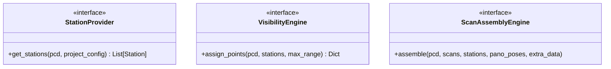

# AV Structure: Terrestrial Laser Scan Reconstruction System

This document serves as the architectural layout and engineering contract for AV Structure.

---

## 1. Product Vision
**AV Structure** reconstructs structured terrestrial laser scans from unstructured point clouds while preserving realistic scanner behavior, deterministic outputs, and embedded panoramic imagery.

---

## 2. Supported Workflows

| Workflow | Status |
| :--- | :--- |
| Unstructured E57 + Pose CSV + External Panos &rarr; Structured E57 | :white_check_mark: Production |
| Unstructured E57 (Embedded Panos) + Pose CSV &rarr; Structured E57 | :white_check_mark: Production |
| Unstructured E57 + Pose CSV (No Panos) | :construction: Future |
| Unstructured E57 Only | :construction: Future |
| LAS/LAZ + Pose CSV | :construction: Planned |
| Geometry-only Reconstruction | :construction: Planned |

---

## 3. Current Production State
The following capabilities represent the working baseline and are protected under a "do not break" contract:
- **Unstructured Input:** Loading E57 (with or without embedded panoramas), LAS/LAZ, PLY, and PCD files.
- **External Panoramas:** Importing and mapping external panorama image directories.
- **Embedded Panoramas:** Parsing and preserving baked-in E57 image structures.
- **Pose CSV parsing:** Transforming coordinates using NavVis CSVs and alignment bundles.
- **Scan Reduction:** Reducing candidate scan density (not 1:1 with pano count).
- **Structured E57 Export:** Finalizing scans and embedding panoramic photo spheres linked to 3D coordinate data.
- **Graphical User Interface (GUI):** A dark-mode CustomTkinter UI.

---

## 4. Golden Release
- **Release Version:** `v1.0.0-Golden`
- **Baseline Status:** Frozen. Backed up to `backup_golden_state/` with computed SHA-256 hashes. Expected outputs and test datasets are isolated and will never be modified. All future builds are regression-tested against this release.

---

## 5. Non-negotiable Product Requirements

### Input / Output
- **Raw Input Protection:** Never modify original E57, original panos, or original CSV files under any circumstance. Everything operates on copies or references.
- **Input Formats:** Must accept unstructured E57 (with or without embedded panos), LAS/LAZ, external panoramas, and pose CSV configurations.
- **Station Source Abstraction:** Downstream components (reconstruction, partitioning, exporting) must never know how stations were generated. They only receive a list of 3D stations and a point cloud.
- **Output Plausibility:** 
  - Every exported scan must have exactly one central, valid panorama/photo sphere (when panorama data exists in the source).
  - No missing or duplicated scans.
  - Preserve all input points unless explicitly filtered by a max range constraint.
  - No point can be assigned to multiple scans.
  - No scan can be written without a valid coordinate pose.

### Performance & Determinism
- **Scale:** Must handle datasets larger than 100 million points without crashing.
- **Determinism:** Running the same project twice with identical inputs and configuration must produce bit-wise identical structured E57 outputs.
- **Diagnostics:** Must provide and log measurable processing statistics per run and per scan.

### Licensing Architecture
- **Decoupled Licensing:** All licensing logic (Community, Professional, Enterprise) must be designed as an outer wrapper/decorator layer. No licensing checks may be embedded directly inside core processing or visibility algorithms.

---

## 6. Phase 1: Commercial Usability & Config
Phase 1 focuses on configuration, usability, validation, and diagnostics. No changes to visibility/partitioning algorithms will be made in this phase.

### A. Project & Job Directory Separation
We separate the long-lived **Project** directory from individual processing runs (**Jobs**). When a project folder is selected, initialize this structure:
```
Project/
├── project.json
├── input/
├── output/
│   ├── Job_001/
│   └── Job_002/
├── logs/
│   ├── Job_001_run.log
│   └── Job_002_run.log
├── cache/
├── thumbnails/
└── temp/
```

#### `project.json` Schema
Tracks project versioning and parameters:
```json
{
    "project_name": "AV_Project_Name",
    "project_format_version": 1,
    "software_version": "1.0.0",
    "minimum_supported_version": "1.0.0",
    "created": "2026-07-03T15:21:46Z",
    "modified": "2026-07-03T15:21:46Z",
    "input_cloud": "input/raw_cloud.las",
    "pose_csv": "input/poses.csv",
    "panorama_folder": "input/panos",
    "alignment_file": "input/alignment.json",
    "output_e57": "output/structured.e57",
    "scan_spacing": 2.5,
    "max_range": 50.0,
    "station_generation": "trajectory",
    "reduce_scans": true,
    "processing_complete": false
}
```

### B. Preflight Integrity Validation
Before loading data or processing starts, run the following pre-flight checks and fail loudly if any fail:
- [ ] Input cloud exists and is readable.
- [ ] Pose CSV exists (if provided) and has valid rows.
- [ ] Every panorama referenced by the CSV exists on disk.
- [ ] Output directory is writable.
- [ ] Sufficient disk space is available for output.
- [ ] Coordinate systems match and are consistent.

### C. Processing Cache & Resume
- Cache intermediate steps (e.g. loaded point cloud bounds, generated stations, optimization outputs) in the `cache/` folder.
- If processing is interrupted, the system can reload the cache and resume directly from the current checkpoint.

### D. Max Scan Range Constraint
- Implemented as a **hard physical constraint** inside the scan simulation.
- If the 3D Euclidean distance between a point and a station is greater than `max_range`, the point is rejected and cannot be assigned to that station.
- Add a slider for `Max Scan Range (m)` (5m to 100m, default 50m) in the GUI settings frame.

### E. Dry Run Mode
- A mode that runs preflight validation, loads the metadata, generates and reduces stations, and stops before performing the expensive scan partitioning and E57 writing.
- **Output:** Report estimated scans, expected runtime, estimated memory usage, estimated output size, and potential warnings.

### F. Stricter Panorama/Scan Validation Export Rules
Prior to starting E57 export, validate that every candidate scan meets these requirements:
- Has a valid station pose (translation/rotation).
- Has a non-empty point cloud.
- Has an associated panorama image file that exists on disk (when in trajectory/pose mode).
- **Abrupt Failure:** If any scan fails validation, the export is aborted immediately, throwing a loud and clear error to prevent silent data corruption.

### G. Validation & Diagnostics Reports
- **Validation Report:** Save a summary `validation_report.txt` (and a JSON copy) in the Job output directory containing overall run diagnostics.
- **Scanner Diagnostics:** Calculate and store detailed statistics for each individual scan inside the report, including:
  - Total Points assigned
  - Average/Maximum Distance of assigned points
  - Overlap percentage with neighboring scans
  - Panorama mapping validation status
  - Rejected points breakdown (out of range, duplicate, occluded)

### H. Processing Determinism
- Replace `np.random.choice` in resolution estimation with uniform deterministic slice sampling (`points[::step]`).
- Sort candidate stations and assigned point indices so that successive runs of the same project yield identical structured E57 outputs.

### I. Processing Manifest
- A permanent `processing_manifest.json` saved inside the Job folder containing:
```json
{
    "input_points": 482736193,
    "output_scans": 226,
    "algorithm": "NearestNeighborEngine",
    "max_range": 50.0,
    "software_version": "1.0.0",
    "processing_time": 537.2,
    "warnings": []
}
```

---

## 7. Phase 2: Visibility Framework
Establish the clean interfaces and extension points. No new partitioning algorithms will be implemented in this phase.



- **`StationProvider`:** Decoupled candidate scan station placement (e.g. `PoseCSVProvider`, `EmbeddedPoseProvider`, `GeometryProvider`).
- **`VisibilityEngine`:** Pluggable visibility analysis (existing engines will be wrapped: `NearestNeighborEngine` and `HPREngine`).
- **`ScanAssemblyEngine`:** Pre-export assembly and formatting, isolating file writers (E57, PTX, etc.) from the core simulation.
- **Feature Flags:** Add configurations to select the active providers and engines.
- **Performance Benchmarks:** Establish an automated benchmark and regression framework comparing execution time, memory overhead, and point-assignment statistics against the Golden Release.

---

## 8. Phase 3: Physical Visibility Research
Research and benchmark candidate visibility algorithms inside the pluggable `VisibilityEngine` framework.

Future visibility assignment will be implemented through the pluggable engine interface. Multiple candidate approaches will be evaluated against the Golden Release using objective benchmarks for accuracy, determinism, performance, and physical realism before a production implementation is selected:
- **Voxel Occupancy Grid:** Trace rays through a discrete voxel grid to check for solid obstructions.
- **2D Viewshed Projection:** Project point slices onto a 2D floor plan to map shadows and wall bounds.
- **Depth-Buffer Visibility:** Render point cloud depth maps from each scan perspective.
- **Hybrid HPR + Occupancy:** Blend convex hull calculations with local geometric verification.

Every experimental algorithm will be developed behind a feature flag and validated against the frozen regression datasets.
